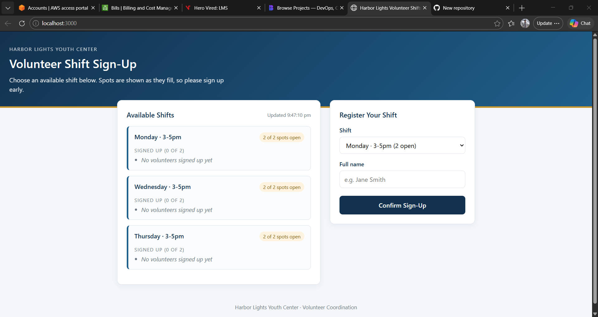
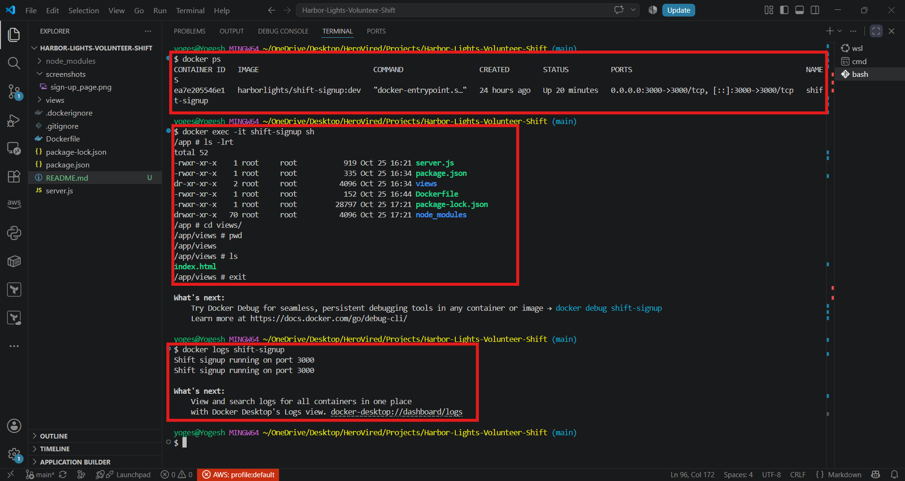
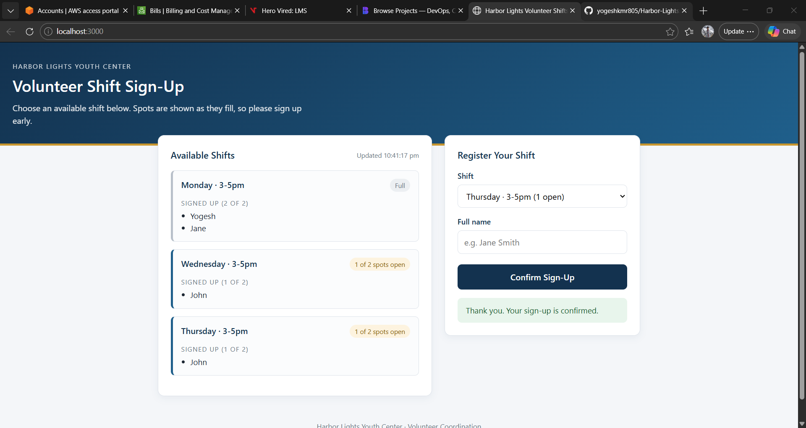
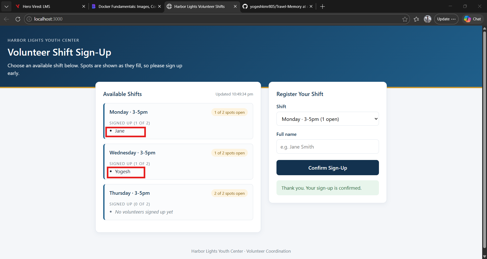
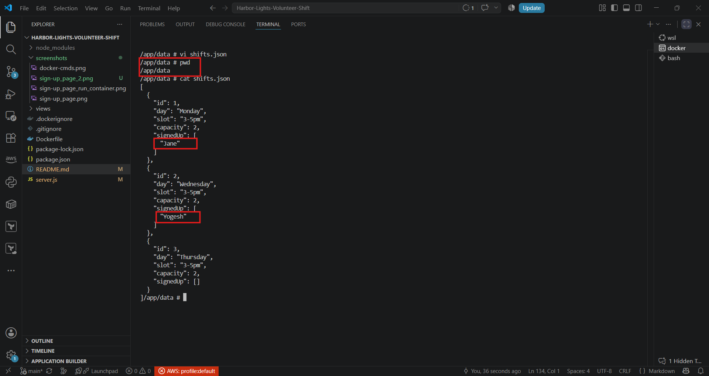
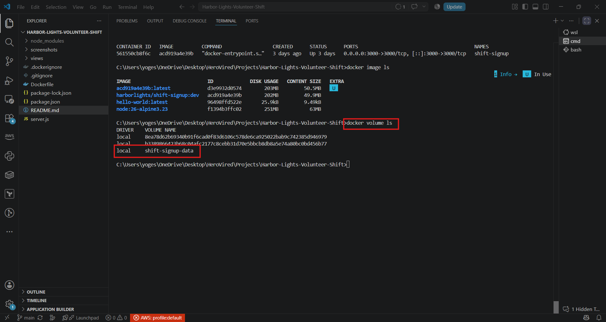

# Harbor Lights Volunteer Shift Sign-Up

A small Node.js and Express app for Harbor Lights Youth Center - a nonprofit that runs after-school programs. Volunteers pick a shift, enter their name, and sign up. The page shows how many spots are left and who has already signed up for each shift.

# Problem Statement #1

Harbor Lights Youth Center used a shared spreadsheet to manage volunteer shifts. It caused double-bookings, missing entries, and gaps in coverage.

Dana Whitfield ( an IT department member ) built a small Node.js and Express app to make sign-ups easier and reduce scheduling errors. It works perfectly on Dana's laptop. The problem starts the moment Dana tries to hand it off — the center's aging front-desk computer, the board president's Mac, and the free-tier server. Harbor Lights just signed up for all have different versions of Node installed, different global packages, and in one case no Node at all. That makes deployment and setup inconsistent and hard to manage.

# Solution
We are going to create a Docker image for the app, so it runs the same way on any computer. The image includes the Node.js version and all dependencies, so the team can run it without installing Node or npm.

## Project layout

```
shift-signup/
├── server.js            # Express server and the shift list
├── package.json         # Project info, dependencies, and start script
├── package-lock.json    # Exact dependency versions (created by npm install)
├── README.md
├── .gitignore
└── views/
    └── index.html       # The sign-up page
```

## Requirements

- **Node.js 20 or newer.** Check with `node -v`.
- **npm**, which comes with Node.js. Check with `npm -v`.
- **Docker**, if you want to run the app in a container. See [Running with Docker](#running-with-docker).

## Setup

1. Copy this folder to the computer that will run the app.
2. Open a terminal **inside this folder**.
3. Install the dependencies:

   ```
   npm install
   ```

   This creates `package-lock.json`, which records the exact version of every package. Keep that file with the project so every computer installs the same versions.

4. Start the app:

   ```
   npm start
   ```

5. Open http://localhost:3000 in a browser.

Below is a screenshot of the sign-up page. Volunteers can choose a shift, type their name, and click **Confirm Sign-Up**.



**Run the app from this folder.** The server finds the `views` folder relative to where you start it. If you start it from another folder, the page shows `Cannot GET /`.


## Using the app

- Volunteers choose a shift from the dropdown, type their full name, and click **Confirm Sign-Up**.
- Full shifts are greyed out and cannot be chosen.
- The page refreshes every 5 seconds, so new sign-ups appear without reloading.

## API

The page uses these endpoints. They can also be called directly.

| Method | Path | Body | Responses |
| ------ | ---- | ---- | --------- |
| `GET` | `/api/shifts` | none | `200` with the list of shifts and who signed up |
| `POST` | `/api/shifts/:id/signup` | `{ "name": "Jane Smith" }` | `200` with the updated shift, `404` if the shift doesn't exist, `409` if it is full |

## Changing the shifts

Open `server.js` and edit the `shifts` list near the top:

```javascript
{ id: 1, day: 'Monday', slot: '3-5pm', capacity: 2, signedUp: [] },
```

- `id`: a unique number for the shift
- `day` and `slot`: the text volunteers see
- `capacity`: how many people the shift needs
- `signedUp`: leave this as `[]`

Restart the app after making changes.

## Running with Docker

Docker packages the app and its Node.js version into one image, so the app runs the same way on any computer. This section assumes a `Dockerfile` sits next to `server.js`.

```
docker build -t harborlights/shift-signup:dev .
docker run -d -p 3000:3000 --name shift-signup harborlights/shift-signup:dev
```

- `docker ps` shows whether the container is running.
- `docker logs -f shift-signup` shows the app's output live.
- `docker exec -it shift-signup sh` opens a shell inside the container.

Below is a screenshot of the above Docker commands executed in a terminal:



Below is a screenshot of the app running in a browser after starting the container:



Sign-ups are stored inside the container, so **removing or recreating the container erases them**, the same as restarting the app.

## Running on a server

- Run `npm start` (or the container) as a background service, or use a process manager such as `pm2`.
- If the app is reachable from the internet, put it behind HTTPS.
- Anyone who opens the page can see the names of volunteers who signed up, and anyone who can reach the API can add names. Only deploy it where that is acceptable.

# Problem Statement #2

Sign-ups are kept in the app's memory only. **If the app stops or the computer restarts, every sign-up is lost** and all shifts reset to empty. Until the app saves to a file or database, keep the app running continuously and keep a copy of the roster if you need a record.

Restarting the container wipes out all volunteer sign-ups because the shifts were stored only in memory inside the container’s writable layer. The board president also wants a live count of remaining volunteer spots on the homepage, updated instantly after each signup.

# Solution

We will edit `server.js` to save the sign-ups to a file at `\app\data\shifts.json` and read that file when the app starts. The file will be created automatically when the first sign-up is made. The app will also send the updated shift list to the browser after each sign-up, so the homepage shows the current number of spots left.

Below is a screenshot of the sign-up page after a few volunteers signed up. The remaining spots are updated instantly:



Below is a screenshot of the `shifts.json` file created with same sign-ups as above:



**But when the container is removed or recreated, the sign-ups are lost again.** Docker gives Dana two ways to make a path survive outside a single container's lifecycle, and they solve different problems. To fix that, we will use below two solutions: Named volumes and Bind mounts.

1. **Named volumes** 
   - Create a named volume to store the `shifts.json` file outside the container. This way, even if the container is removed or recreated, the sign-ups persist.

        ```
     docker volume create shift-signup-data
        ```

    - Update the Docker run command to mount the named volume.
        ```
        docker run -d -p 3000:3000 -v shift-signup-data:/app/data \
        --name shift-signup harborlights/shift-signup:dev
        ```
        Below is a screenshot of the named volume created in a terminal: 

        
        
2. **Bind mounts**
   - Use a bind mount to link a folder on the host machine to the container's `/app/data` directory. This way, the `shifts.json` file is stored on the host machine and persists even if the container is removed or recreated.

        ```
        docker run -d -p 3000:3000 -v /path/to/host/folder:/app/data \
        --name shift-signup harborlights/shift-signup:dev
        ```

    - Replace `/path/to/host/folder` with the actual path on your host machine where you want to store the `shifts.json` file.
    

## Troubleshooting

- **`'npm' is not recognized`** (Windows): Node.js is not installed or not on the PATH. Install the LTS version from https://nodejs.org, keep the default options, then open a new terminal.
- **`Cannot GET /`**: the app was started from a different folder. Stop it, go into this folder, and start it again.
- **`Port already in use`**: another program is using the port. Start the app with a different `PORT`.
- **`npm ci` says `package-lock.json` is missing**: run `npm install` once on a computer with internet access, then copy the new `package-lock.json` with the project.
- **Sign-ups disappeared**: the app or container was restarted. See "Important: sign-ups are not saved" above.
- **Sign-up says "Shift is full"**: the shift has reached its capacity. Choose another shift, or raise `capacity` in `server.js` and restart.

## Known limitations

- Sign-ups are not saved between restarts.
- The server does not check the name. An empty name is accepted when the request is sent directly to the API. The page requires a name.
- There is no login. Anyone who can reach the app can sign up volunteers or view the list.
- The same person can sign up for the same shift more than once.